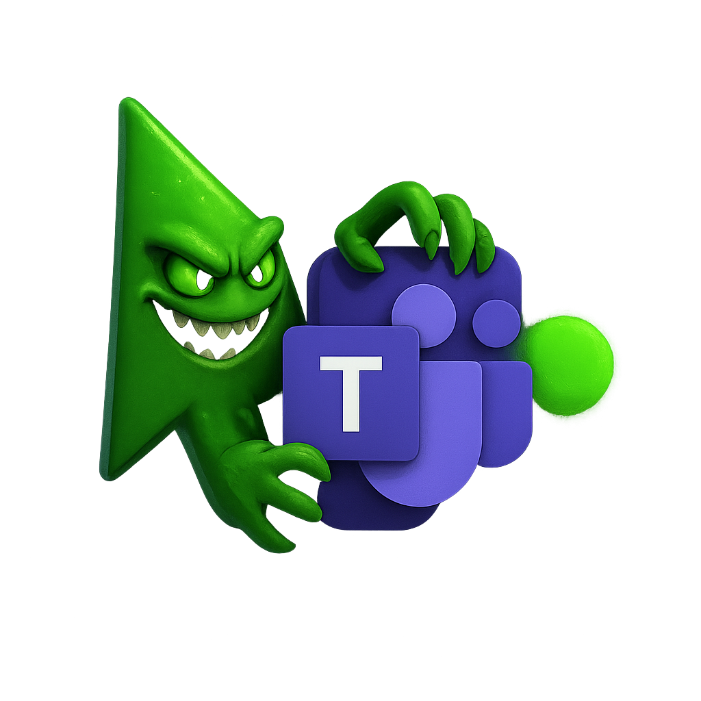

<h1 align="center">KeepTeamsGreen</h1>

<p align="center">
  Mantieni attivo lo stato verde nelle piattaforme di collaborazione e controlla cosa sta succedendo da una piccola centrale operativa.
</p>
<p align="center">
  
</p>

**KeepTeamsGreen** e un'applicazione open source per Windows che monitora il tempo di inattivita e, quando serve, genera micro-movimenti del cursore. La versione 2.3.3 migliora l'attivazione di Teams gia aperto in background e verifica il primo piano prima delle azioni automatiche. Mantiene la lettura contatti dalla colonna conversazioni della 2.3.2, il lettore personale e gli avvisi corretti, il jitter limitato a Teams e il widget personalizzabile.

> [!IMPORTANT]
> Il tool non modifica la presenza tramite API Microsoft e non promette uno stato che non riesce a verificare. Mantiene attiva la sessione simulando un minimo input del cursore; Teams conserva sempre il controllo finale della presenza.

## Centrale operativa

Il nuovo pannello mostra in tempo reale:

- stato del motore di protezione;
- stato presenza esposto da Teams: Disponibile, Assente, Occupato, Non disturbare o Offline;
- presenza o meno del focus sulla finestra di Teams;
- tempo di inattivita, prossimo jitter, ultimo intervento e numero di interventi;
- alert con popup locale e suono configurabile quando uno stato verde confermato cambia;
- stato esplicito `Non rilevato` quando Teams non rende disponibile un dato affidabile.

Il focus viene individuato dalla finestra Windows in primo piano. La presenza viene letta tramite **Windows UI Automation**, cioe dai controlli accessibili esposti dall'interfaccia di Teams. Questo approccio non usa credenziali, token o traffico di rete.

Il controllo personale viene richiesto ogni 2 secondi, separatamente dalla scansione contatti. Dopo aver individuato il controllo account ne aggiorna le proprieta, senza ripercorrere tutta la chat. Una scansione contatti lenta o incompleta non annulla una lettura personale valida. La frequenza richiesta non garantisce i tempi di risposta del provider Windows/Teams. L'uscita dal verde richiede conferma per almeno 2 secondi (5 se la finestra viene chiusa); un breve dato mancante resta visibile come Non rilevato ma conserva il riferimento precedente per massimo 20 secondi per non perdere l'avviso successivo. Dati piu vecchi diventano una nuova lettura iniziale, senza inventare transizioni.

## Funzioni principali preservate

- **Soglia di inattivita**: tempo senza input prima di preparare l'intervento.
- **Tempo tra i jitter**: range minimo/massimo configurabile da 1 a 600 secondi. Il default e `3 / 3`, cioe un jitter ogni 3 secondi; valori diversi introducono un'attesa casuale nel range.
- **Ampiezza jitter**: spostamento massimo in pixel.
- **Modalita visibile**: il cursore resta nella nuova posizione.
- **Modalita stealth**: il cursore torna subito alla posizione originale.
- **Start e Stop**: disponibili sia dal pannello sia dal menu tray.

## Contatti e regole locali (2.2)

Apri **CONTATTI E REGOLE**, aggiungi una persona e scrivi il nome completo esattamente come appare in Teams. Seleziona:

- `Available`: avvisa alla prima disponibilita confermata e ai successivi ritorni a Disponibile;
- `Change`: avvisa sui cambi di stato confermati dopo una prima lettura di riferimento;
- giorni (`Weekdays` = lun-ven, `Weekend` = sab-dom, `Everyday` = tutti) e fascia `HH:mm`;
- intervallo di controllo (5-300 secondi, default 15) e pausa minima tra gli avvisi della stessa persona (60-3600 secondi, default 120).

Attiva il monitor e premi **SALVA REGOLE**. Il salvataggio di questa finestra e indipendente dalle impostazioni jitter del pannello principale. La watchlist accetta fino a 40 nomi. Le modifiche alle regole azzerano le osservazioni precedenti.

La lettura e **passiva dalla colonna conversazioni**. Windows UI Automation identifica la riga con il nome completo e cerca il badge nella stessa riga, anche quando nome e avatar sono elementi fratelli o annidati. Le sezioni Preferiti/Chat vengono attraversate; il contenuto della conversazione selezionata sulla destra non viene usato. Il tool non apre chat, non scorre la lista e non cerca persone automaticamente. I contatti fuori dall'interfaccia caricata, i nomi non riconosciuti, le righe duplicate, gli indicatori discordanti e i dati scaduti mostrano **Non rilevato**, mai Offline per deduzione. Gli omonimi non sono distinguibili con certezza: usare solo etichette univoche nella propria interfaccia.

Se il badge non espone un testo accessibile, **Leggi anche il colore dei badge visibili nella colonna chat** (attivo per default, disattivabile con SALVA REGOLE) tenta una stima leggendo solo un piccolo riquadro di pixel in basso a destra dell'avatar. Occorrono un nome esatto e un solo avatar individuati nella stessa riga tramite accessibilita: non viene effettuato OCR dei nomi o dei messaggi. Il riquadro deve appartenere alla finestra Teams e non essere coperto; Teams minimizzato, cattura fallita o colori/forme ambigui producono Non rilevato. Non vengono salvati screenshot o immagini. Nome e posizione dell'avatar vengono ricontrollati prima e dopo il campionamento per scartare le righe spostate o riciclate da Teams. Il tooltip dello stato indica se la fonte e accessibilita oppure una stima del colore.

Il colore riconosce verde (Disponibile), giallo (Assente) e rosso. Il rosso viene mostrato come **Rosso (Occupato / Non disturbare)**: il solo colore non distingue i due stati, mentre un indicatore accessibile puo distinguerli. Il passaggio da rosso generico a uno stato rosso piu preciso non genera un falso avviso di cambio. Il grigio non viene interpretato come Offline. Temi, zoom e versioni di Teams possono influire sul riconoscimento: il fallback e euristico, non una lettura della presenza server.

**Non e un monitor contatti garantito in background.** Non serve aprire la scheda della persona, ma la sua riga deve essere caricata nella colonna chat. Il fallback visivo richiede inoltre che il badge sia effettivamente sullo schermo e non coperto; nascondere KTG nella tray non impedisce il monitoraggio se Teams resta visibile. Il tool non forza il focus per leggere i contatti. La scheda Diagnostica mostra quante righe sono state esaminate, e il tooltip di ogni stato spiega eventuali dati mancanti.

Ogni stato richiede due letture coerenti distanziate di almeno 3 secondi. La freschezza scade dopo il maggiore tra 45 secondi e tre intervalli di controllo; una lettura senza indicatore invalida subito lo stato. Le letture scadute non generano avvisi di cambio stato. Gli orari si riferiscono al PC; una fascia notturna e attribuita al giorno in cui inizia, e orari uguali significano 24 ore.

La tabella mostra anche l'ora dell'ultima osservazione. **Controlla ora** anticipa la prossima lettura; **Silenzia contatti 15 min** sospende gli avvisi senza bloccare le letture. Il monitor contatti funziona anche quando il motore jitter e fermo.

## Fasce personali, focus e recupero

In **Orari e recupero** puoi limitare la protezione a giorni e fascia oraria. Premi Avvia nel pannello principale per armare il motore: attende fuori fascia e riprende nella fascia. Stop lo disarma. Il programma deve essere aperto: non crea attivita pianificate in Windows.

Il recupero opzionale esegue un jitter sul passaggio personale confermato **Verde > Assente**, al massimo una volta ogni due minuti, e controlla il ritorno a verde entro 30 secondi. Il risultato indica una nuova osservazione, non una garanzia che il jitter abbia modificato la presenza. Occupato e Non disturbare non vengono modificati. **Porta Teams davanti** permette di recuperare il focus su richiesta; Windows potrebbe non concederlo.

### Autofocus (2.3)

In **CONTATTI E REGOLE > Autofocus** abilita l'autofocus e scegli il trigger: Teams Assente, Teams in background o entrambi. Puoi impostare l'attesa di inattivita prima dell'intervento (default 5 secondi) e la pausa fra interventi (default 60 secondi). Il trigger Assente richiede letture confermate. L'autofocus e disabilitato per impostazione predefinita.

Le azioni indipendenti sono **Sposta il puntatore al centro della finestra Teams** e **Avvia auto-jitter su Teams anche se il motore e fermo**. Prima viene richiesto e verificato il focus; solo se riesce vengono eseguite le altre azioni. Se Windows nega il cambio di finestra, il mouse e il motore non vengono modificati. L'autofocus non effettua clic ne cambia lo stato Teams tramite API.

Dalla **2.3.3**, l'attivazione viene richiesta anche quando Teams e gia aperto in secondo piano: la finestra viene mostrata e portata in cima con richieste asincrone, preservando dimensioni e stato massimizzato. Se minimizzata viene ripristinata. Il timer attende fino a 3 secondi e fa al massimo un secondo tentativo dopo 1 secondo, senza bloccare l'interfaccia; una richiesta accettata o l'icona lampeggiante non vengono considerate una conferma di focus. Mouse e jitter scattano solo dopo avere verificato che Teams sia davvero la finestra in primo piano. Stop, blocco Windows, nuove impostazioni, ripresa dell'input durante un tentativo automatico o selezione di un'altra finestra annullano il seguito dell'operazione. Le richieste troppo vecchie (ad esempio dopo una sospensione del PC) vengono scartate.

Windows puo comunque negare l'attivazione da un processo in background: in quel caso puo limitarsi a far lampeggiare l'icona Teams. Il limite viene riportato nella Diagnostica, senza dichiarare un falso successo. Non vengono modificati il registro o le regole globali sul focus, ne inviati tasti/clic sintetici per aggirare il blocco; Teams non viene mantenuto permanentemente in primo piano.

Con l'avvio jitter selezionato, il primo intervento avviene subito; poi si applicano la soglia di inattivita e il range min/max salvati. I movimenti restano entro l'area client di Teams: se il focus passa altrove o il mouse esce dalla finestra, il jitter attende. Se lo spostamento del mouse e disattivato, occorre che il puntatore sia gia nella finestra per eseguire i movimenti.

**Stop** disarma anche l'autofocus automatico per la sessione; **Avvia**, **Autofocus rapido** o disabilitare e riabilitare l'opzione lo riarmano. Le fasce orarie e il blocco Windows valgono anche per l'autofocus rapido. Il comando rapido non richiede di abilitare il trigger automatico e usa le azioni gia salvate. Quando l'autofocus e abilitato, sostituisce il solo jitter della precedente opzione di recupero, evitando due interventi contemporanei.

Quando Windows e bloccato o il desktop non e accessibile, il jitter e la lettura vengono sospesi. Allo sblocco si scartano le osservazioni precedenti. Dopo la sospensione del PC i dati troppo vecchi vengono invalidati.

## Diagnostica e dati locali

La scheda **Diagnostica** mostra salute del lettore, ultima lettura, stato del recupero, ultimi 100 eventi in memoria ed errori con codice e contatore. I tentativi falliti applicano un'attesa crescente fino a due minuti. Una lettura UI Automation bloccata non avvia altri worker: dopo 12 secondi viene segnalato il timeout e i dati vecchi non vengono accettati. **Riprova lettura Teams** riparte appena il provider precedente ha terminato; se rimane bloccato e necessario riavviare il tool/Teams.

Il log ruota a 1 MiB conservando una copia precedente. **Esporta diagnostica** salva versione, contatori e codici errore, escludendo nomi e stati dei colleghi, configurazione, percorsi personali e log grezzi. I nomi della watchlist sono salvati nel `config.json` locale, gli stati e gli orari di osservazione restano in memoria e non vengono registrati nel log. Il programma non effettua richieste Graph, login Microsoft, webhook o telemetria. La normale attivita di rete di Teams rimane gestita da Teams.

## Tray, taskbar e icona

Il logo mostrato in questo README viene ora usato anche dalla finestra e dall'icona nell'area di notifica. La gestione della finestra e stata resa coerente:

- `X` e il pulsante Riduci a icona nascondono il pannello, ma non fermano il motore e non eliminano l'icona tray;
- doppio clic sull'icona tray riapre il pannello e ripristina correttamente il pulsante nella barra delle applicazioni;
- **Esci** dal menu tray chiude davvero timer, widget e icona;
- l'avvio minimizzato non forza la ricomparsa del pannello.

## Mostriciattolo

Attiva **Mostra il mostriciattolo quando la protezione e attiva** per avere un piccolo widget sempre in primo piano:

- `GREEN OK` quando Teams espone uno stato Disponibile;
- `CHECK TEAMS` quando viene rilevato uno stato diverso;
- `STATO NON LETTO` in giallo quando il motore lavora ma la presenza non e verificabile;
- `MONITOR SPENTO` quando il controllo della presenza e disattivato.

Il widget si puo trascinare, aprire con doppio clic o nascondere dal menu contestuale.

Da **CONTATTI E REGOLE > Widget e suoni** puoi impostare dimensione (60-200%) e opacita (25-100%), con anteprima immediata. Premi **SALVA REGOLE** per conservarle al prossimo avvio.

La freccia accanto allo stato apre un menu sotto il widget con **Autofocus rapido** e gli stati dei primi tre contatti salvati che risultano abilitati nella fascia corrente. L'ordine e quello della watchlist. Gli indicatori scaduti o non leggibili restano `Non rilevato`, come nel pannello. Se il widget si trova a fondo schermo, viene spostato quanto basta per lasciare spazio al menu. Il widget non prende il focus quando appare.

### Suoni degli avvisi

La scheda **Widget e suoni** offre **Sistema Windows**, **Allarme**, **Sirena**, **Allarme nucleare** e **Silenzioso**, con anteprima e pulsante per interrompere gli effetti. Gli effetti sono brevi suoni sintetizzati originali incorporati nel programma: non servono WAV esterni. Il volume configurabile riguarda gli effetti sintetizzati; il suono di sistema usa il volume Windows.

Gli avvisi personali e dei contatti usano un popup locale che non prende il focus e il suono scelto. Questo evita il doppio suono dei balloon Windows; in modalita Silenzioso restano gli avvisi visivi. Avvisi simultanei non sovrappongono gli effetti sonori e gli avvisi dei contatti rispettano lo snooze. La comparsa iniziale del pannello e la riduzione in tray non producono allarmi.

**Prova popup + suono** verifica la catena di notifica senza attendere cambi di Teams, usando il suono e il volume selezionati anche prima del salvataggio. La scheda Diagnostica mostra l'ultima richiesta audio, il silenziamento o gli errori di riproduzione: una richiesta riuscita non conferma che gli altoparlanti abbiano emesso audio. Se il popup fallisce, viene tentato il balloon tray e il suono viene comunque richiesto separatamente. Per una verifica udibile scegli Allarme e volume maggiore di zero; Sistema Windows dipende anche dallo schema suoni di Windows. L'avviso quando premi X rimane volutamente silenzioso.

## Impostazioni affidabili

La configurazione viene validata e salvata in modo atomico in:

```text
%APPDATA%\KeepTeamsGreen\config.json
```

Prima di sostituire un file esistente viene mantenuto anche `config.backup.json`. Gli errori non vengono piu ignorati: il pannello mostra l'esito reale e il dettaglio viene scritto in `%APPDATA%\KeepTeamsGreen\last_run.log`. Le configurazioni della versione precedente vengono migrate automaticamente con valori sicuri per le nuove opzioni.

## Avvio

Su Windows 10 o 11, dalla cartella del progetto:

```powershell
powershell.exe -NoProfile -ExecutionPolicy Bypass -STA -File .\script.gui.ps1
```

Durante lo sviluppo e consigliato eseguire direttamente `script.gui.ps1`, cosi il comportamento corrisponde sempre al sorgente corrente. `KeepTeamsGreen.exe` deve essere rigenerato su Windows dopo ogni modifica del sorgente.

Per creare l'eseguibile standalone con script, logo e icona incorporati serve [.NET SDK 8](https://dotnet.microsoft.com/download/dotnet/8.0) o successivo. Esegui:

```powershell
.\build.ps1
```

La build valida prima la sintassi, incorpora anche `logo.png` per il widget e conserva l'eseguibile precedente come `KeepTeamsGreen.previous.exe`.
I moduli in `local/` sono incorporati nell'EXE: basta copiare l'eseguibile sul PC Windows. Per l'avvio da sorgente servono anche i file nella cartella `local/`.

Verifica delle regole (eseguibile anche con PowerShell 7 su Linux):

```powershell
pwsh -NoProfile -File ./tests/Test-LocalRules.ps1
pwsh -NoProfile -File ./tests/Test-Interactions.ps1
pwsh -NoProfile -File ./tests/Test-PresencePipeline.ps1
```

Il collaudo della pipeline esegue i lettori reali contro un provider UIA simulato e verifica la macchina degli avvisi, i worker separati, le righe conversazione e il dispatch audio anche quando il popup fallisce. La classificazione visiva usa riquadri sintetici; la cattura viene provata con risposte native simulate (occlusione, minimizzazione, DPI, coordinate negative, identita riciclata e rilascio delle risorse). Non verifica la compatibilita con un'installazione reale di Teams, i colori di ogni tema o l'uscita audio del PC.

Collaudo dell'interfaccia reale su Windows PowerShell 5.1, con configurazione temporanea isolata:

```powershell
powershell.exe -NoProfile -STA -File .\tests\Smoke-Windows.ps1
```

### Firma digitale e SmartScreen

I campi `Company` e `Product` nei dettagli dell'EXE non definiscono il publisher mostrato da Windows. Per ottenere `Autore: Markino Solutions` serve un certificato attendibile con uso **Code Signing** e relativa chiave privata. Se il certificato e installato nello store personale di Windows, la build puo firmare e verificare automaticamente l'eseguibile:

```powershell
.\build.ps1 `
  -SigningCertificateThumbprint 'THUMBPRINT_CERTIFICATO' `
  -TimestampServer 'URL_TIMESTAMP_FORNITO_DALLA_CA'
```

Senza `-SigningCertificateThumbprint` la build continua, ma segnala chiaramente che l'EXE resta senza firma. Per un test locale di un file ricevuto tramite browser si puo controllare **Proprieta > Annulla blocco** oppure, dopo aver verificato origine e contenuto, usare:

```powershell
Unblock-File .\KeepTeamsGreen.exe
```

## Limiti del monitor Teams

Microsoft puo cambiare struttura e nomi dei controlli dell'interfaccia. Se il pulsante del profilo non espone la presenza a Windows UI Automation, KeepTeamsGreen mostra `Non rilevato` e non genera un falso alert di cambio stato. Teams nel browser e riconosciuto quando il titolo della finestra contiene `Microsoft Teams`; la lettura della presenza dipende comunque dai controlli accessibili del browser.

## Compatibilita

- Windows 10 e Windows 11;
- Windows PowerShell 5.1 in modalita STA;
- client Teams classico, nuovo client `ms-teams` e Teams aperto nei browser piu comuni;
- nessuna credenziale Microsoft richiesta.

## Stack tecnologico

- **PowerShell 5.1**: interfaccia WinForms, motore jitter, configurazione, tray e coordinamento generale.
- **C# / .NET Framework 4.8**: launcher standalone, interoperabilita Win32 e lettura asincrona di Teams tramite UI Automation.
- **XML / MSBuild**: definizione del progetto e processo di compilazione dell'eseguibile.
- **JSON**: configurazione persistente in `%APPDATA%`.
- **Markdown**: documentazione del progetto.

## Disclaimer legale

Questo progetto e completamente indipendente e non affiliato a Microsoft, Slack, Zoom o altre piattaforme di collaborazione. Microsoft Teams e i relativi marchi appartengono a Microsoft Corporation. L'uso del termine "Teams" nel nome e puramente descrittivo.

## Licenza

Il progetto e distribuito con licenza [Apache 2.0](LICENSE).
